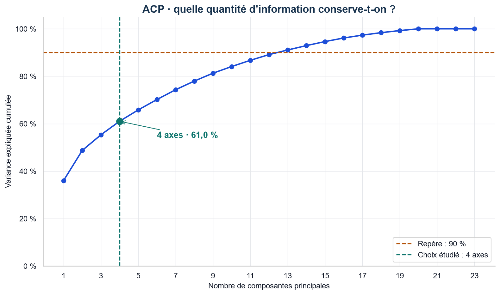
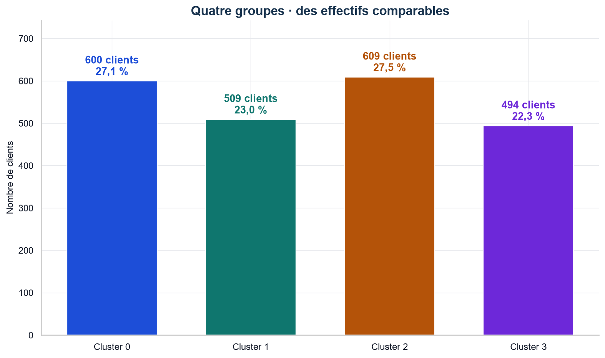
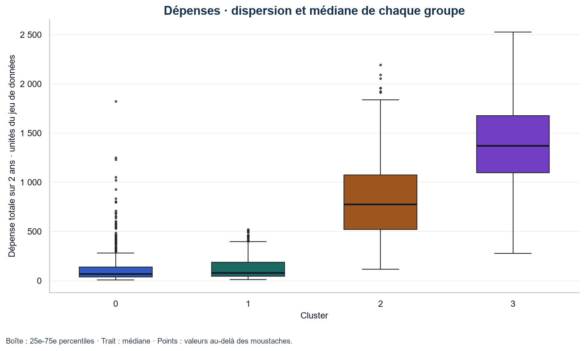

# Segmentation de la clientèle marketing

> **In English.** Customer segmentation of 2,212 retail customers (Kaggle Customer Personality Analysis): data cleaning, feature engineering, PCA and Ward hierarchical clustering into four segments, with silhouette, Davies-Bouldin and robustness checks.
> Results are framed as descriptive profiles and testable marketing hypotheses, not causal claims; two interactive 3D views can be explored in the browser.
> ENSEA group project (Data Mining course, 2025), later reworked and extended by Abdoulaye KONE.

**Comprendre les profils d’achat et formuler des hypothèses de ciblage.**

Un parcours complet de data analysis : exploration de toutes les variables, nettoyage, création de caractéristiques, ACP, clustering, évaluation et restitution des profils. Projet de groupe du cours de Data Mining, **ENSEA Abidjan**, AS3, juillet 2025, repris et enrichi par Abdoulaye KONE.

|     Clients analysés     |    Segments étudiés    |     Variance conservée     |                Silhouette                |
| :-----------------------: | :----------------------: | :-------------------------: | :--------------------------------------: |
| **2 212** sur 2 240 | **4** groupes Ward | **61,0 %** sur 4 axes | **0,304** · séparation modérée |


**Résultat principal.** Les groupes présentent des différences de revenu, de dépenses et de composition du foyer. Le cluster 2 enregistre le plus d’achats en promotion ; le cluster 3, surtout composé de foyers sans enfant, a les dépenses et le taux de réponse à la dernière campagne les plus élevés. Ces résultats sont **descriptifs** : ils ne démontrent ni l’effet d’une remise ni la rentabilité d’une campagne.

**Accès direct :** [notebook complet](customer_segmentation.ipynb) · [présentation de restitution](reports/restitution_segmentation.pptx) · [résultats](#résultats-et-profils) · [reproduction](#reproduire-lanalyse)

## Explorer les clients en 3D


Deux vues interactives permettent de **tourner, zoomer, lire le profil d’un point et masquer un groupe** :

- [Projection ACP avant segmentation](https://abdoul4kone.github.io/segmentation-clientele-marketing/reports/figures_interactives/projection_acp_3d.html)
- [Projection des quatre clusters](https://abdoul4kone.github.io/segmentation-clientele-marketing/reports/figures_interactives/clusters_3d.html)

Les deux vues s’ouvrent directement dans le navigateur, sans installation ; Plotly est chargé depuis son CDN officiel, une connexion internet est donc nécessaire. Les fichiers sont aussi disponibles dans [reports/figures_interactives](reports/figures_interactives/). Le notebook propose aussi ces interactions dans VS Code/Jupyter, avec un aperçu statique de secours. GitHub affiche les notebooks de façon statique et n’exécute pas leur JavaScript. [Documentation GitHub](https://docs.github.com/en/repositories/working-with-files/using-files/working-with-non-code-files#working-with-jupyter-notebook-files-on-github)

La vue 3D montre les **trois premiers axes : 55,3 % de la variance**. Le modèle utilise **quatre axes : 61,0 %**. Une projection ne représente donc pas toute l’information utilisée pour former les groupes.

## Données et qualité

Source : [Customer Personality Analysis](https://www.kaggle.com/datasets/imakash3011/customer-personality-analysis), publié par Akash Patel sur Kaggle. Le fichier contient **2 240 clients et 29 variables**, avec des inscriptions de juillet 2012 à juin 2014. Les montants sont exprimés dans les **unités monétaires du jeu de données**, sans conversion en euros.

| Dimension               | Nombre de variables | Exemples                                                                                         |
| :---------------------- | ------------------: | :----------------------------------------------------------------------------------------------- |
| Profil et inscription   |                   7 | Naissance, éducation, situation matrimoniale, revenu, enfants, adolescents, date d’inscription |
| Dépenses sur deux ans  |                   6 | Vin, fruits, viande, poisson, sucreries, produits en or                                          |
| Promotions et réponses |                   7 | Cinq acceptations de campagne, achats en promotion, réponse à la dernière campagne            |
| Canaux et visites       |                   4 | Web, catalogue, magasin, visites web du dernier mois                                             |
| Autres informations     |                   5 | Identifiant, récence, réclamation, deux constantes                                             |

**Traçabilité du nettoyage :** 2 240 clients → retrait de **24 revenus manquants** → 2 216 → retrait de **4 observations atypiques** → **2 212 clients**. Les trois âges d’au moins 90 ans et le revenu de 666 666 sont exclus avec les seuils `Age < 90` et `Income < 600000`.

Le notebook présente l’inventaire des variables, les statistiques descriptives numériques et catégorielles, les valeurs manquantes, les distributions et les corrélations. Il crée sept variables : ancienneté relative, âge en 2014, dépense totale, cohabitation, nombre d’enfants, taille du foyer et statut parental. La suppression de 1,1 % des lignes pour revenu manquant ne garantit pas l’absence de biais de sélection.

## Du fichier brut aux segments

| Étape                                           | Décision et contrôle                                                                                         |
| :----------------------------------------------- | :------------------------------------------------------------------------------------------------------------- |
| **01 · Explorer et nettoyer**             | Inventaire des 29 variables, statistiques, manquants, distributions et seuils documentés.                     |
| **02 · Construire les caractéristiques** | Sept variables dérivées ; identifiants et constantes retirés.                                               |
| **03 · Préparer la représentation**     | Encodage des catégories et standardisation des 23 variables retenues.                                         |
| **04 · Réduire la dimension**            | ACP à quatre axes, conservant 61,0 % de la variance ; comparaison à la courbe cumulée.                      |
| **05 · Former les groupes**               | Clustering agglomératif, critère de Ward, quatre segments. Coude KMeans utilisé comme repère exploratoire. |
| **06 · Évaluer**                         | Silhouette et Davies-Bouldin pour deux à huit groupes ; quatre tests de robustesse.                          |
| **07 · Restituer**                        | Profils, distributions, canaux, réponses aux campagnes et hypothèses commerciales à tester.                 |




**Séparation et choix du nombre de groupes.** Quatre groupes offrent davantage de détail descriptif. Ils n’obtiennent pas les meilleurs indices internes :

|    Groupes Ward    |   Silhouette ↑ | Davies-Bouldin ↓ |
| :-----------------: | --------------: | ----------------: |
|          2          | **0,390** |   **0,885** |
|          3          |           0,336 |             1,141 |
| 4 · choix étudié |           0,304 |             1,188 |

**Robustesse.** Toute la chaîne (standardisation, ACP, Ward) est réestimée en changeant un choix de préparation à la fois :

| Variante | Indice de Rand ajusté | Clients conservés |
| :--- | ---: | ---: |
| Éducation codée dans l’ordre des diplômes | 0,81 | 92,3 % |
| Revenu et dépenses transformés par `log1p` | 0,76 | 90,3 % |
| Sans les variables dérivées redondantes | **0,53** | **78,3 %** |
| 100 sous-échantillons de 80 % (médiane ; 5e centile) | 0,81 ; 0,67 | - |

L’encodage et l’asymétrie des montants modifient peu les segments. La redondance pèse davantage : `Spent`, `Children`, `Family_Size` et `Is_Parent` donnent un poids supplémentaire aux dépenses et au foyer, et leur retrait déplace environ un client sur cinq. Les profils principaux se retrouvent dans les sous-échantillons, avec des frontières qui varient.

Leur utilité commerciale reste à évaluer. Les achats en promotion et les canaux font partie du clustering : leurs différences entre groupes ne sont pas une validation indépendante. Les cinq acceptations de campagne et la dernière réponse sont exclues de la construction des groupes et examinées ensuite.

## Résultats et profils



| Segment                                                       | Clients | Revenu moyen | Dépense moyenne sur 2 ans | Profil observé                                                                 |
| :------------------------------------------------------------ | ------: | -----------: | -------------------------: | :------------------------------------------------------------------------------ |
| **0 · Jeunes foyers à faible revenu**                 |     600 |       31 164 |                        130 | Âge moyen 37 ans ; 72,7 % de parents.                                          |
| **1 · Foyers avec enfants, faibles dépenses**         |     509 |       42 642 |                        127 | Âge moyen 49 ans ; 100 % de parents.                                           |
| **2 · Foyers avec enfants, dépenses intermédiaires** |     609 |       60 135 |                        833 | Âge moyen 48 ans ; 99,8 % de parents ; davantage d’achats en promotion.       |
| **3 · Foyers surtout sans enfant, fortes dépenses**   |     494 |       76 736 |                      1 404 | Âge moyen 46 ans ; 94,5 % sans enfant ; davantage d’acceptations de campagne. |

Les moyennes ne suffisent pas à résumer la dispersion interne. Les groupes ne sont pas des catégories figées prédisant le comportement de chaque client.



**Promotions.** Le cluster 2 effectue **3,7 achats en promotion en moyenne**, contre **1,1** pour le cluster 3. Cette observation ne prouve pas que le premier est plus sensible au prix ou que le second aurait acheté sans remise.


**Campagnes.** **79,3 %** des clients n’ont accepté aucune des cinq campagnes. Le cluster 3 présente le taux de réponse positive le plus élevé à la dernière campagne : **30,6 %**, contre **6,1 %** pour le cluster 1. Les expositions individuelles, les coûts et un groupe témoin ne sont pas disponibles : on ne peut pas en déduire l’efficacité causale des campagnes ni un défaut de ciblage.


## Hypothèses commerciales à tester

| Segment     | Piste expérimentale                                      | Mesure nécessaire                                                     |
| :---------- | :-------------------------------------------------------- | :--------------------------------------------------------------------- |
| **0** | Tester des messages ou parcours web adaptés.             | Achats additionnels, avec visites et achats sur la même période.     |
| **1** | Comparer plusieurs offres pour les foyers avec enfants.   | Réponses et achats supplémentaires face à un groupe témoin.        |
| **2** | Comparer une offre avec remise à une offre sans remise.  | Achats supplémentaires et marge, avec le coût réel de la remise.    |
| **3** | Tester une campagne autour d’une sélection de produits. | Réponses, achats supplémentaires et marge face à un groupe témoin. |

Aucun gain de ventes, économie ou profit n’est établi par cette analyse.

## Limites et améliorations méthodologiques

- **Qualité de séparation :** modérée ; deux et trois groupes ont de meilleurs indices internes. Quatre groupes ne sont pas présentés comme l’optimum statistique.
- **Représentation :** quatre axes écartent environ 39 % de la variance. Comparer plusieurs nombres de composantes et utiliser un dendrogramme compléterait le repère KMeans pour le modèle Ward.
- **Redondance :** `Spent` et ses composantes, ainsi que plusieurs caractéristiques du foyer, représentent plusieurs fois les mêmes thèmes. Sans les quatre variables dérivées, 78,3 % des clients restent dans le même segment : c’est la principale fragilité du modèle.
- **Encodage :** `LabelEncoder` classe l’éducation par ordre alphabétique, sans progression scolaire cohérente. Le test avec un codage ordonné conserve 92,3 % des affectations ; un encodage adapté reste préférable pour une nouvelle version du modèle.
- **Nettoyage :** évaluer le biais lié aux 24 revenus supprimés et la sensibilité aux seuils ; une imputation doit être comparée, sans supposer qu’elle améliore automatiquement le résultat.
- **Stabilité :** assez bonne en médiane sur les sous-échantillons (0,81), mais variable (5e centile 0,67). Aucune validation sur une période indépendante n’est possible avec ces données.
- **Lecture commerciale :** les visites web couvrent le dernier mois ; leurs ratios avec les achats ne sont pas des taux de conversion établis. Les données ne permettent pas d’identifier un effet causal des campagnes ou des remises.

## Reproduire l’analyse

Depuis le terminal, avec Python 3.12 :

```bash
git clone https://github.com/abdoul4Kone/segmentation-clientele-marketing.git
cd segmentation-clientele-marketing
python -m venv .venv
```

Activez l’environnement dans **PowerShell** :

```powershell
.\.venv\Scripts\Activate.ps1
```

Ou sur **macOS/Linux** :

```bash
source .venv/bin/activate
```

Installez les dépendances et ouvrez le notebook :

```bash
python -m pip install -r requirements.txt
jupyter notebook customer_segmentation.ipynb
```

Dans VS Code, sélectionnez le noyau de cet environnement, puis lancez **Run All** depuis la racine du dépôt. L’exécution régénère les huit PNG et les deux HTML interactifs. Les sorties sont aussi enregistrées pour lire les résultats sans relancer l’analyse. Les cellules de code peuvent être dépliées lorsque l’interface les masque.

**Validation du 22 octobre 2026 :** dans un environnement neuf créé depuis `requirements.txt`, les 34 cellules de code s’exécutent sans erreur ni avertissement. Effectifs, scores et profils sont identiques à la version précédente ; les figures ne diffèrent que par la mise en forme française des nombres (virgule décimale, espace des milliers) et par leurs notes. Les 17 diapositives ont été contrôlées dans PowerPoint. Environnement : Python 3.12.0, pandas 3.0.6, NumPy 2.5.3, scikit-learn 1.9.1, Plotly 6.9.0, Matplotlib 3.11.2 et Seaborn 0.13.2.

## Contenu du dépôt

```text
customer_segmentation.ipynb                Parcours complet, avec sorties et graphiques 3D
README.md                                 Synthèse, résultats, limites et reproduction
requirements.txt                          Dépendances Python, dont Plotly
data/marketing_campaign.csv               Données sources publiques, inchangées
images/00_... à 07_...png                  Huit figures de restitution
reports/restitution_segmentation.pptx      Présentation de restitution (17 diapositives)
reports/figures_interactives/              Deux vues 3D interactives au format HTML
reports/profilage_clusters.pptx            Support initial du groupe (juillet 2025), archive non retouchée
LICENSE                                   Licence MIT du code
```

**Outils :** Python · pandas · NumPy · scikit-learn · Matplotlib · Seaborn · Plotly · Jupyter.

## Sources et contribution

- **Données :** [Customer Personality Analysis](https://www.kaggle.com/datasets/imakash3011/customer-personality-analysis), Akash Patel, Kaggle, licence CC0 (domaine public).
- **Démarche initiale :** [Customer Segmentation: Clustering](https://www.kaggle.com/code/karnikakapoor/customer-segmentation-clustering), Karnika Kapoor. La préparation et l’enchaînement ACP + clustering agglomératif s’en inspirent. L’évaluation, l’interprétation et le profilage sont propres au projet.

Projet de groupe réalisé sous la supervision de **M. LALY**, ENSEA Abidjan.

**KONE Abdoulaye** : nettoyage et création des variables, ACP, choix des segments et rédaction de l’analyse.
**N’GUESSAN Kouamé Kan Armand Loïc · SAWADOGO Wend-yam Albert · CHEFOUET CHETSONG Ghislain Joël** : membres de l’équipe.

**Reprise individuelle (2026).** Abdoulaye KONE a ensuite enrichi seul le projet : exploration détaillée des 29 variables, évaluation par silhouette et Davies-Bouldin, profils et limites réécrits avec une lecture descriptive, vues 3D interactives, nouvelle présentation de restitution et contrôle de reproduction. L’historique Git conserve la version du groupe et les étapes de cette reprise.

## Licence

Le code et l’analyse sont publiés sous [licence MIT](LICENSE). Les données restent sous licence CC0 de leur auteur.

---

**Abdoulaye KONE - analyste statisticien, diplômé de l’ENSEA Abidjan**
[LinkedIn](https://linkedin.com/in/abdoulaye-kone) · [GitHub](https://github.com/abdoul4Kone)
