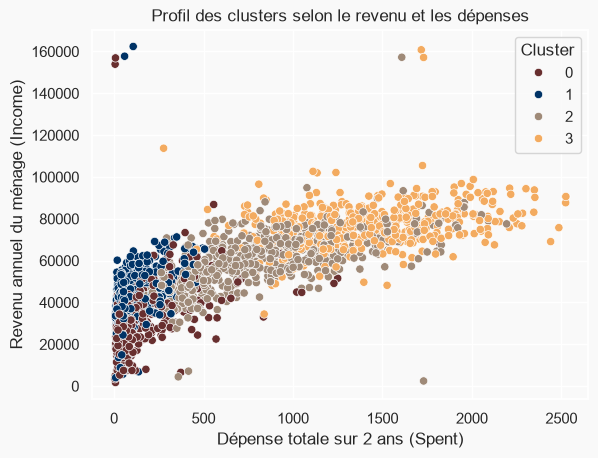
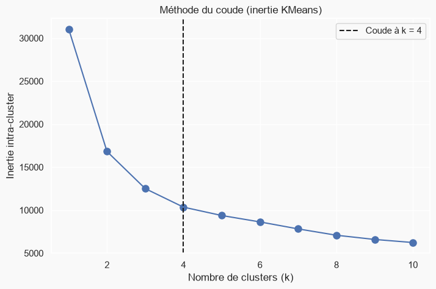
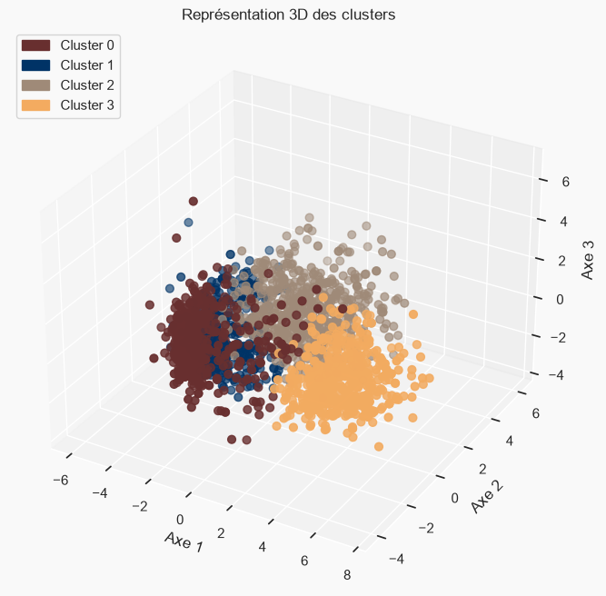
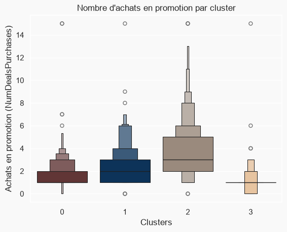
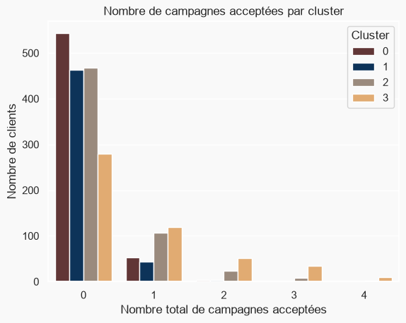

# Segmentation de la clientèle par clustering non supervisé

Identification de **4 segments de clients** à partir de 2 212 clients d'une enseigne de grande distribution, pour permettre un ciblage marketing différencié plutôt qu'une communication uniforme.

**Résultat clé :** les segments se distinguent nettement par le revenu, les dépenses et la présence d'enfants, mais surtout par leur **réaction aux actions commerciales** : les **remises** et les **campagnes marketing** ne touchent pas les mêmes clients. Les familles aisées (cluster 2) achètent le plus en promotion, tandis que les clients premium sans enfant (cluster 3) achètent peu en promotion mais sont ceux qui répondent le mieux aux campagnes. Une politique promotionnelle uniforme est donc inadaptée.



---

## Contexte

Projet académique réalisé en équipe dans le cadre du cours de Data Mining, **ENSEA Abidjan, promotion AS3 — juillet 2025**.

L'énoncé posait le problème du point de vue de l'entreprise : disposant d'une base de 2 240 clients, comment constituer des groupes homogènes permettant de proposer des offres ciblées plutôt qu'une offre unique ?

## Données

`marketing_campaign.csv` — 2 240 clients, 29 variables, jeu de données public [*Customer Personality Analysis*](https://www.kaggle.com/datasets/imakash3011/customer-personality-analysis) (Kaggle). Les inscriptions des clients s'étalent de juillet 2012 à juin 2014.

| Dimension | Variables | Exemples |
|---|---|---|
| Profil socio-démographique | 7 | année de naissance, niveau d'éducation, statut matrimonial, revenu du ménage, enfants et adolescents à charge, date d'inscription |
| Dépenses sur 2 ans | 6 | vin, fruits, viande, poisson, sucreries, produits de luxe (or) |
| Réponse aux promotions | 7 | acceptation de chacune des 5 campagnes, achats en promotion, réponse à la dernière campagne |
| Canaux d'achat | 4 | site web, catalogue, magasin, visites du site sur le dernier mois |
| Autres | 5 | identifiant, jours depuis le dernier achat, réclamation, 2 variables constantes |

## Démarche

**Nettoyage et création de variables.** 24 clients sans revenu déclaré ont été écartés (2 240 → 2 216), puis 4 valeurs aberrantes : 3 années de naissance invraisemblables et un revenu de 666 666 (2 216 → **2 212 clients retenus**). Sept variables ont été construites pour rendre les profils interprétables : ancienneté du client dans la base, âge (calculé en 2014, fin de la période observée), dépense totale, situation de cohabitation, nombre d'enfants, taille du foyer et statut de parent.

**Réduction de dimension.** La matrice de corrélation révélait une forte redondance entre les variables de dépenses. Une **ACP** a été appliquée après standardisation des 23 variables retenues : les 3 premières composantes expliquent 55,3 % de la variance, et **4 composantes ont été retenues (61 % de la variance)**. Le seuil de 90 % n'aurait été atteint qu'à la 13ᵉ composante, au prix de la lisibilité : l'arbitrage retenu privilégie l'interprétabilité.

**Choix du nombre de segments.** La méthode du coude, appliquée aux composantes principales, situe l'inflexion entre 3 et 4 clusters ; **k = 4** a été retenu pour sa finesse opérationnelle.



**Segmentation.** Un **clustering agglomératif** (approche hiérarchique ascendante, critère de Ward) à 4 groupes a été appliqué sur les 4 axes de l'ACP.



**Évaluation.** Le coefficient de silhouette vaut **0,30** et l'indice de Davies-Bouldin **1,19** : la séparation est modérée, ce qui est courant sur des données de clientèle aux comportements continus. La silhouette serait un peu plus élevée avec 2 ou 3 groupes, mais une segmentation aussi grossière opposerait simplement les gros et les petits dépensiers.

## Résultats

Les quatre segments sont d'effectifs comparables (entre environ 490 et 610 clients chacun), ce qui écarte le risque d'un segment résiduel non exploitable.

| Segment | Effectif | Revenu moyen | Dépense moyenne (2 ans) | Profil familial | Réaction commerciale |
|---|---|---|---|---|---|
| **Cluster 0** — Jeunes foyers modestes | 600 | 31 k | 130 | Les plus jeunes (37 ans en moyenne) ; 3 sur 4 sont parents d'enfants en bas âge ; foyers de 1 à 3 personnes | Visitent souvent le site mais achètent peu |
| **Cluster 1** — Familles nombreuses à budget serré | 509 | 43 k | 127 | Tous parents, souvent d'un adolescent et d'un jeune enfant ; foyers de 2 à 5 personnes ; les plus âgés (49 ans) | Réponse la plus faible à la dernière campagne (6 %) |
| **Cluster 2** — Familles aisées sensibles aux promotions | 609 | 60 k | 833 | Tous parents, surtout d'adolescents ; foyers de 2 à 5 personnes ; 48 ans | **Record d'achats en promotion** (3,7 en moyenne) ; très actifs sur le web |
| **Cluster 3** — Clients premium sans enfant | 494 | 77 k | 1 404 | 95 % sans enfant ; foyers de 1 à 2 personnes ; 46 ans | Peu d'achats en promotion (1,1) mais **le plus de campagnes acceptées** ; 31 % de réponse à la dernière campagne |

**L'enseignement exploitable.** Les clients du **cluster 2**, au pouvoir d'achat intermédiaire à élevé, achètent le plus en promotion, tandis que le **cluster 3**, le plus dépensier, en achète très peu. Accorder des remises au cluster 3 reviendrait donc à subventionner des achats qui auraient eu lieu de toute façon ; ce segment réagit en revanche mieux aux **campagnes** que tous les autres. Les deux leviers doivent être ciblés séparément.



Par ailleurs, **près de 8 clients sur 10 n'ont accepté aucune des cinq campagnes** et aucun ne les a toutes acceptées : un indice que les campagnes passées étaient insuffisamment ciblées.



## Limites et pistes d'amélioration

- Le nombre de clusters a été déterminé par la méthode du coude appliquée à **KMeans**, alors que la segmentation finale utilise un clustering **agglomératif**. Un dendrogramme aurait été plus cohérent avec l'algorithme retenu.
- La séparation des groupes est **modérée** (silhouette ≈ 0,30). Comparer d'autres algorithmes (KMeans, modèles de mélange gaussien) permettrait de tester la stabilité des segments.
- Plusieurs variables familiales redondantes (`Kidhome`, `Teenhome`, `Children`, `Family_Size`, `Is_Parent`), ainsi que la dépense totale et ses composantes, pèsent davantage dans l'ACP. Une sélection de variables plus parcimonieuse est une piste d'amélioration.
- Le niveau d'éducation est encodé par ordre alphabétique (`LabelEncoder`) plutôt que par niveau d'études ; un encodage ordinal modifie sensiblement les clusters et mériterait d'être étudié.
- Les valeurs manquantes de revenu ont été **supprimées** plutôt qu'imputées. Sur 24 observations et 2 240, l'impact est marginal, mais une imputation par la médiane du niveau d'éducation aurait été plus rigoureuse.

## Reproduire l'analyse

```bash
git clone https://github.com/<TON-PSEUDO>/customer-segmentation-clustering.git
cd customer-segmentation-clustering
pip install -r requirements.txt
jupyter notebook customer_segmentation.ipynb
```

L'exécution complète du notebook régénère les figures du dossier `images/`.

## Contenu du dépôt

```
customer_segmentation.ipynb      Analyse complète, de l'exploration au profilage
data/marketing_campaign.csv      Jeu de données (2 240 clients, 29 variables)
images/                          Figures générées par le notebook
reports/profilage_clusters.pptx  Présentation de restitution des segments
```

## Outils

Python (pandas, NumPy) · scikit-learn (ACP, clustering agglomératif, KMeans, silhouette) · Matplotlib, Seaborn, missingno

## Sources et crédits

- **Données :** [*Customer Personality Analysis*](https://www.kaggle.com/datasets/imakash3011/customer-personality-analysis), Akash Patel, Kaggle.
- **Démarche :** la préparation des données et l'enchaînement ACP + clustering agglomératif s'inspirent du notebook Kaggle [*Customer Segmentation: Clustering*](https://www.kaggle.com/code/karnikakapoor/customer-segmentation-clustering) de Karnika Kapoor. L'évaluation de la segmentation, l'interprétation des résultats et le profilage des clusters ont été réalisés par l'équipe.

---

## Équipe et contribution

Projet de groupe réalisé sous la supervision de M. LALY, ENSEA Abidjan.

**KONE Abdoulaye** — nettoyage et création des variables, ACP, choix du nombre de segments, rédaction de l'analyse
N'GUESSAN Kouamé Kan Armand Loïc · SAWADOGO Wend-yam Albert · CHEFOUET CHETSONG Ghislain Joël

> Les analyses de ce dépôt sont réalisées à des fins pédagogiques et de démonstration.

**Abdoulaye KONE** — Statisticien, diplômé de l'ENSEA
[LinkedIn](https://linkedin.com/in/abdoulaye-kone)
